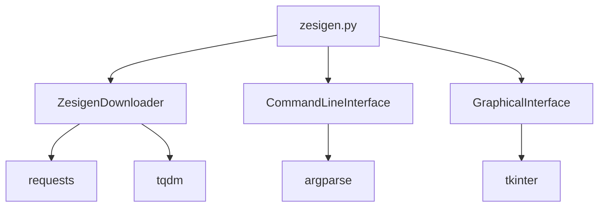

# Zesigen 开发者指南

本指南面向 Zesigen 项目的开发者，介绍项目结构、开发流程和贡献规范。

## 目录

1. [项目架构](#项目架构)
2. [开发环境设置](#开发环境设置)
3. [代码结构](#代码结构)
4. [构建系统](#构建系统)
5. [测试](#测试)
6. [贡献指南](#贡献指南)
7. [发布流程](#发布流程)

## 项目架构

### 技术栈

- **语言**: Python 3.8+
- **GUI框架**: Tkinter（标准库）
- **构建工具**: PyInstaller
- **CI/CD**: GitHub Actions
- **包管理**: pip + requirements.txt

### 设计模式

项目采用模块化设计，主要包含以下组件：

1. **核心下载器** (`ZesigenDownloader`): 处理HTTP请求、文件下载
2. **命令行界面** (`CommandLineInterface`): 处理命令行参数和交互
3. **图形界面** (`GraphicalInterface`): 提供GUI操作界面
4. **主控制器** (`main`): 协调不同组件的工作

### 依赖关系



## 开发环境设置

### 1. 克隆仓库

```bash
git clone https://github.com/zhangchengmc/Zesigen.git
cd Zesigen
```

### 2. 创建虚拟环境（推荐）

```bash
# Windows
python -m venv venv
venv\Scripts\activate

# macOS/Linux
python3 -m venv venv
source venv/bin/activate
```

### 3. 安装依赖

```bash
pip install -r requirements.txt

# 安装开发依赖
pip install black flake8 mypy pytest
```

### 4. 安装预提交钩子（可选）

```bash
# 安装 pre-commit
pip install pre-commit

# 设置git钩子
pre-commit install
```

## 代码结构

### 目录结构

```
Zesigen/
├── src/                    # 源代码
│   └── zesigen.py         # 主程序
├── docs/                  # 文档
│   ├── USER_GUIDE.md      # 用户指南
│   └── DEVELOPER_GUIDE.md # 开发者指南
├── tests/                 # 测试代码
├── assets/               # 资源文件
│   └── icon.icns         # macOS图标
├── .github/workflows/    # GitHub Actions
│   ├── build-all-platforms.yml
│   ├── quick-build.yml
│   └── test-windows.yml
├── requirements.txt      # Python依赖
├── pyproject.toml       # 项目配置
├── .pre-commit-config.yaml # 预提交配置
├── LICENSE              # 许可证
└── README.md           # 项目说明
```

### 主要类说明

#### ZesigenDownloader

核心下载器类，负责所有下载逻辑。

**主要方法**：
- `download_file()`: 下载单个文件
- `download_multiple_files()`: 多线程下载多个文件
- `get_filename_from_url()`: 从URL提取文件名

**特性**：
- 支持进度回调
- 自动重试机制
- 连接超时处理

#### CommandLineInterface

命令行界面处理器。

**主要方法**：
- `show_version()`: 显示版本信息
- `show_help()`: 显示帮助信息
- `run_cli()`: 运行命令行模式

**特性**：
- 完整的参数解析
- 友好的错误提示
- 支持从文件读取URL

#### GraphicalInterface

图形用户界面。

**主要组件**：
- URL输入区域
- 设置面板
- 进度显示
- 日志输出

**特性**：
- 响应式布局
- 多线程UI更新
- 文件导入功能

## 构建系统

### 本地构建

```bash
# 开发模式运行
python src/zesigen.py --version

# 构建可执行文件
pyinstaller --onefile src/zesigen.py

# 构建带图标的版本（macOS）
pyinstaller --windowed --icon=assets/icon.icns src/zesigen.py
```

### GitHub Actions 构建

项目配置了多个GitHub Actions工作流：

1. **build-all-platforms.yml**: 全平台自动构建
2. **quick-build.yml**: 快速构建指定平台
3. **test-windows.yml**: Windows测试

### 构建配置

在 `pyproject.toml` 中配置构建选项：

```toml
[build-system]
requires = ["setuptools", "wheel"]
build-backend = "setuptools.build_meta"

[tool.black]
line-length = 88
target-version = ['py38']

[tool.flake8]
max-line-length = 88
extend-ignore = ["E203"]
```

## 测试

### 测试框架

项目使用 pytest 进行测试。

### 运行测试

```bash
# 运行所有测试
pytest

# 运行特定测试文件
pytest tests/test_downloader.py

# 带详细输出
pytest -v

# 生成覆盖率报告
pytest --cov=src --cov-report=html
```

### 测试目录结构

```
tests/
├── __init__.py
├── conftest.py          # 测试配置
├── test_downloader.py   # 下载器测试
├── test_cli.py         # 命令行测试
└── test_gui.py         # 图形界面测试
```

### 编写测试

示例测试用例：

```python
def test_downloader_get_filename():
    """测试从URL提取文件名"""
    downloader = ZesigenDownloader()

    url = "https://example.com/file.zip"
    filename = downloader.get_filename_from_url(url)

    assert filename == "file.zip"

    url_with_query = "https://example.com/file.zip?param=value"
    filename = downloader.get_filename_from_url(url_with_query)

    assert filename == "file.zip"
```

### 模拟测试

对于网络请求，使用 pytest-mock 进行模拟：

```python
def test_download_file_success(mocker):
    """测试成功下载文件"""
    mock_response = mocker.Mock()
    mock_response.headers = {'content-length': '1024'}
    mock_response.iter_content.return_value = [b'data' * 256]
    mock_response.raise_for_status.return_value = None

    mocker.patch('requests.Session.get', return_value=mock_response)

    downloader = ZesigenDownloader()
    result = downloader.download_file("https://example.com/test.txt", "/tmp/test.txt")

    assert result is True
```

## 贡献指南

### 代码规范

1. **PEP 8**: 遵循Python官方代码风格
2. **类型提示**: 使用类型注解
3. **文档字符串**: 为所有公共函数添加docstring
4. **注释**: 复杂的逻辑需要注释说明

### 提交信息规范

使用约定式提交：

```
feat: 添加新功能
fix: 修复bug
docs: 更新文档
style: 代码格式调整
refactor: 代码重构
test: 添加或修改测试
chore: 构建过程或辅助工具的变动
```

示例：
```
feat: 添加断点续传功能
fix: 修复多线程下载的内存泄漏问题
docs: 更新用户指南中的示例
```

### 开发流程

1. **创建分支**：
   ```bash
   git checkout -b feature/your-feature-name
   ```

2. **编写代码**：
   - 遵循代码规范
   - 添加测试用例
   - 更新文档

3. **运行测试**：
   ```bash
   pytest
   black src/
   flake8 src/
   mypy src/
   ```

4. **提交更改**：
   ```bash
   git add .
   git commit -m "feat: 描述你的更改"
   ```

5. **推送分支**：
   ```bash
   git push origin feature/your-feature-name
   ```

6. **创建Pull Request**：
   - 描述更改内容
   - 关联相关Issue
   - 等待代码审查

### 代码审查标准

1. **功能正确性**: 代码是否按预期工作
2. **代码质量**: 是否遵循代码规范
3. **测试覆盖**: 是否有足够的测试
4. **文档更新**: 是否更新了相关文档
5. **性能影响**: 是否影响程序性能
6. **向后兼容**: 是否破坏现有功能

## 发布流程

### 版本管理

使用语义化版本控制：

- **主版本号**: 不兼容的API修改
- **次版本号**: 向下兼容的功能性新增
- **修订号**: 向下兼容的问题修正

### 发布步骤

1. **更新版本号**：
   - 修改 `src/zesigen.py` 中的 `__version__`
   - 更新 `CHANGELOG.md`

2. **创建发布分支**：
   ```bash
   git checkout -b release/v1.0.0
   ```

3. **运行完整测试**：
   ```bash
   # 运行所有测试
   pytest

   # 检查代码质量
   black --check src/
   flake8 src/
   mypy src/
   ```

4. **构建所有平台**：
   - 通过GitHub Actions手动触发构建
   - 验证构建产物

5. **创建Git标签**：
   ```bash
   git tag -a v1.0.0 -m "Release version 1.0.0"
   git push origin v1.0.0
   ```

6. **创建GitHub Release**：
   - 基于标签创建Release
   - 上传构建产物
   - 编写发布说明

7. **合并到主分支**：
   ```bash
   git checkout main
   git merge release/v1.0.0
   git push origin main
   ```

### 自动化发布

GitHub Actions 会自动处理：
- 代码检查
- 测试运行
- 多平台构建
- 发布包上传

## 高级主题

### 跨平台兼容性

注意事项：

1. **路径处理**：
   ```python
   import os

   # 使用 os.path.join 而不是字符串拼接
   save_path = os.path.join(output_dir, filename)

   # 创建目录时使用 exist_ok=True
   os.makedirs(output_dir, exist_ok=True)
   ```

2. **文件权限**：
   ```python
   # 设置可执行权限（Linux/macOS）
   if hasattr(os, 'chmod'):
       os.chmod(executable_path, 0o755)
   ```

3. **GUI差异**：
   - Tkinter在不同平台上的表现可能不同
   - 测试所有平台的GUI布局

### 性能优化

1. **内存管理**：
   - 使用流式下载避免内存溢出
   - 及时关闭文件句柄
   - 使用适当的数据结构

2. **并发控制**：
   - 限制最大线程数
   - 使用线程池管理资源
   - 避免线程竞争

3. **网络优化**：
   - 设置合理的超时时间
   - 使用连接池
   - 支持断点续传

### 安全性考虑

1. **输入验证**：
   - 验证URL格式
   - 防止路径遍历攻击
   - 清理文件名中的特殊字符

2. **网络安全**：
   - 验证SSL证书
   - 防止重定向攻击
   - 限制重定向次数

3. **文件安全**：
   - 检查文件大小限制
   - 验证文件类型（可选）
   - 防止覆盖系统文件

## 故障排除

### 常见开发问题

**问题**: PyInstaller 打包后程序无法运行
**解决方案**：
1. 检查隐藏导入：`pyinstaller --hidden-import=module`
2. 添加数据文件：`--add-data "source:dest"`
3. 使用调试模式：`pyinstaller --debug`

**问题**: Tkinter 在不同平台显示不一致
**解决方案**：
1. 使用 ttk 控件确保一致性
2. 测试所有平台的布局
3. 使用平台特定的样式

**问题**: 多线程下载导致程序崩溃
**解决方案**：
1. 使用线程安全的队列
2. 限制最大线程数
3. 添加异常处理

### 调试技巧

1. **日志调试**：
   ```python
   import logging

   logging.basicConfig(level=logging.DEBUG)
   logger = logging.getLogger(__name__)
   logger.debug("调试信息")
   ```

2. **pdb调试**：
   ```python
   import pdb
   pdb.set_trace()  # 设置断点
   ```

3. **性能分析**：
   ```bash
   python -m cProfile -o profile.stats src/zesigen.py
   snakeviz profile.stats  # 可视化分析
   ```

## 资源链接

- [Python官方文档](https://docs.python.org/3/)
- [Tkinter文档](https://docs.python.org/3/library/tkinter.html)
- [PyInstaller手册](https://pyinstaller.readthedocs.io/)
- [GitHub Actions文档](https://docs.github.com/en/actions)
- [语义化版本控制](https://semver.org/)

---

感谢您对 Zesigen 项目的贡献！如有任何问题，请随时在GitHub上提出Issue或参与讨论。